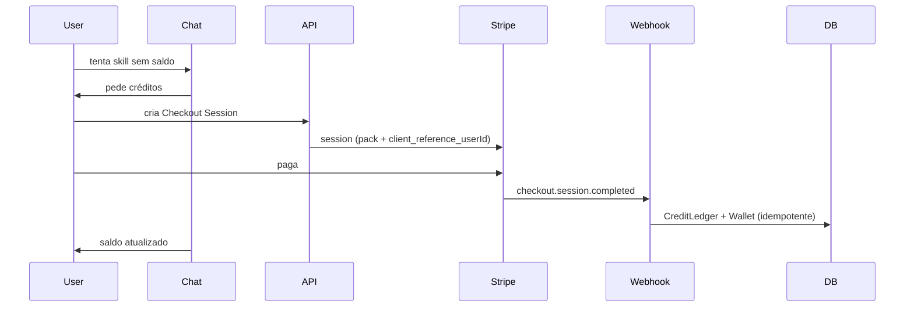

# Rows — billing e créditos

Overview: [`overview.md`](./overview.md) · Skills: [`skills.md`](./skills.md) · MVP: [`../product/mvp.md`](../product/mvp.md)

## Modelo

- Saldo em `Wallet.balance` (unidade: crédito)
- Toda movimentação passa por `CreditLedger` (append-only)
- Compra de packs via **Stripe Checkout**
- Skills e `inline_complete` debitam antes de executar; falha → estorno

## Packs (exemplo MVP)

| Pack | Créditos | Uso típico |
|------|----------|------------|
| Starter | 100 | Diagnóstico + primeiras edições |
| Pro | 500 | Várias iterações de artefatos |
| Power | 1500 | Uso intenso + muitos inlines |

Boas-vindas opcionais: `+50` no signup (ledger `reason=welcome`).

## Fluxo de compra

## Stripe

- **Checkout Session** modo `payment` (packs one-shot; sem assinatura no MVP)
- Metadata / `client_reference_id`: `userId`, `packId`, `credits`
- Webhook endpoint: `/api/stripe/webhook`
- Verificar assinatura (`STRIPE_WEBHOOK_SECRET`)
- Evento principal: `checkout.session.completed`
- Idempotency: chave = `stripeSessionId` (ou `event.id`) no ledger; reentrega não credita de novo
- Customer Portal: só histórico/faturas no MVP (opcional)

## Ledger

Campos mínimos:

- `id`, `userId`, `delta` (+compra / −skill / +estorno)
- `reason`: `welcome` | `purchase` | `skill_charge` | `skill_refund` | `inline_charge`
- `skillRunId?`, `stripeSessionId?`
- `createdAt`

Consultas: saldo = última wallet (não recalcular full scan em hot path); reconciliar periodicamente com sum(ledger).

## Gate no chat

1. Chat/orchestrator consulta `Wallet.balance`
2. Se `balance < skill.creditCost` → não executa; UI oferece Checkout
3. Após webhook, cliente atualiza saldo (poll, websocket ou return URL)

## Segurança

- Nunca confiar no client para creditar
- Só o webhook (assinado) ou jobs internos de estorno alteram saldo positivamente além do welcome controlado
- Rate limit na criação de Checkout Sessions por usuário
