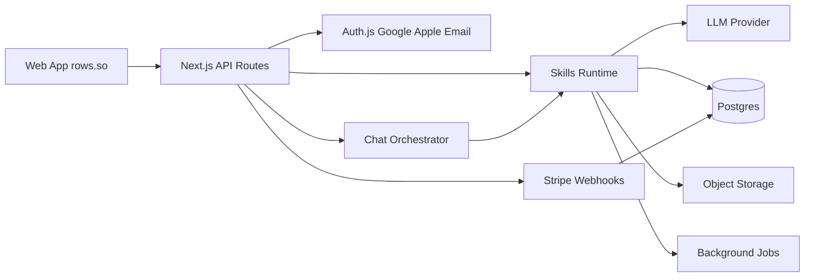

# Rows — arquitetura (overview)

Produto: [`../product/vision.md`](../product/vision.md) · MVP: [`../product/mvp.md`](../product/mvp.md)  
Skills: [`skills.md`](./skills.md) · Billing: [`billing.md`](./billing.md)

## Stack

| Camada | Escolha |
|--------|---------|
| App | Next.js (App Router) + TypeScript + Tailwind |
| Auth | Auth.js (NextAuth v5) — Google, Apple, Credentials/e-mail |
| DB | PostgreSQL (Neon) + Prisma |
| Storage | S3-compatible (R2/S3) para uploads |
| Jobs | Inngest ou Trigger.dev (parse, diagnóstico, export) |
| AI | Anthropic ou OpenAI via `lib/skills/` (provider trocável) |
| Parse | PDF: pdf-parse / unpdf + estruturação LLM; DOCX: mammoth |
| Export | `docx` + PDF (react-pdf ou Gotenberg); templates Rows / US / EU |
| Billing | Stripe Checkout + webhooks |
| Host | Vercel + domínio `rows.so` |
| Observabilidade | Sentry + logs de usage/créditos |

## Diagrama lógico



## Fluxo runtime (alto nível)

1. Auth cria sessão + `User` / `Wallet`.
2. Chat orquestra turns; se saldo insuficiente, redireciona/abre Stripe Checkout.
3. Uploads vão ao object storage; job `parse_documents` estrutura o perfil.
4. `diagnose_profile` e gerações gravam `SkillRun` + artifacts / revisions.
5. Editor consome revisions; `inline_complete` é sync e barato.
6. Preview LinkedIn lê o artefato LinkedIn atual (sem chamar a API do LinkedIn).
7. `export_pack` materializa arquivos por template.

## Modelo de dados (essencial)

- `User` — id, email, providers (`google` | `apple` | `email`)
- `Wallet` — userId, balance, updatedAt
- `CreditLedger` — delta, reason, skillRunId?, stripeSessionId? (idempotency)
- `Document` — type (`cv` | `linkedin_pdf`), storageKey, mime, status
- `Profile` / `ProfileRevision` — JSON estruturado + parentRevisionId
- `Diagnosis` / `DiagnosisVersion` — output do diagnóstico, ligado ao profile
- `Artifact` / `ArtifactRevision` — tipo (`cv` | `linkedin` | `experience`), conteúdo, parent
- `SkillRun` — skillId, input, output, creditsCharged, status, tokens
- `Export` — revisionId(s), template (`rows` | `us` | `eu`), files[]
- `ChatThread` / `ChatMessage` — superfície pós-login

`CareerPlan` fica **fora** do schema MVP desta trilha (branch Plan futura).

## Layout de código (alvo)

```
app/
  (marketing)/
  (app)/
    chat/
    editor/
    preview/
    billing/
    imports/
    exports/
  api/auth/
  api/stripe/webhook/
  api/skills/
lib/
  auth/
  billing/stripe.ts
  credits/wallet.ts
  chat/
  skills/
    registry.ts
    parse_documents.ts
    diagnose_profile.ts
    generate_artifacts.ts
    edit_section.ts
    rewrite_experience.ts
    inline_complete.ts
    export_pack.ts
  parse/
  export/templates/{rows,us,eu}/
  diff/
  preview/linkedin/
prisma/schema.prisma
```

## Auth

- Google OAuth + Sign in with Apple (`https://rows.so/api/auth/callback/apple`)
- E-mail: conta no banco do Rows (magic link ou senha — detalhe de implementação no scaffold)
- E-mail como identidade canônica; account linking entre providers com o mesmo e-mail
- Sessão JWT ou database session (Auth.js)

## Segurança e compliance

- Uploads privados (URLs assinadas); retenção configurável
- Política clara: não treinar modelos com docs do usuário (default)
- Rate limit por user nas skills e no inline complete
- Webhooks Stripe com assinatura verificada + idempotency keys
- LGPD: export/delete account no roadmap próximo; no MVP, delete via suporte + endpoint interno

## Ordem de implementação

1. Skeleton Next.js + Prisma + Auth (Google / Apple / e-mail)
2. Wallet + Stripe Checkout + webhook
3. Chat pós-login + gate de créditos
4. Upload + parse + ProfileRevision
5. Diagnóstico + geração de artefatos
6. Editor (diff + inline) + Preview LinkedIn
7. Export pack (3 templates)
8. Landing + polish rows.so

## Riscos e mitigações

| Risco | Mitigação |
|-------|-----------|
| PDF LinkedIn mal estruturado | Parser híbrido (heurística + LLM) + UI de correção |
| Alucinação de experiências | Prompt + validação: só fatos nas fontes |
| Custo LLM alto | Caps por skill, model routing, fração no inline |
| Apple SSO setup | Documentar Service ID, key e callbacks |
| Expectativa de postar no LinkedIn | Copy claro + preview; extensão no roadmap |
