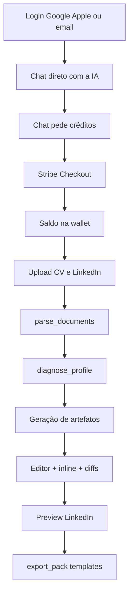

# Rows — escopo MVP

Documento de produto. Visão: [`vision.md`](./vision.md).

## Personas e jobs-to-be-done

- **Profissional em transição** — quer CV/LinkedIn alinhados a um cargo/indústria alvo.
- **Quem busca promoção** — quer reforçar impacto e narrativa sem inventar experiência.
- **Recém-formado / early career** — quer se posicionar com clareza a partir do que já tem.

Job do MVP: *“Entro, resolvo créditos, mando CV + LinkedIn, recebo diagnóstico, edito artefatos ao vivo, vejo o preview e exporto.”*

## Princípios (MVP)

1. **Diagnóstico antes da reescrita** — parse e diagnóstico precedem geração de artefatos.
2. **Precisão e controle** — edição em tempo real + diffs/aceite por seção; sugestão inline opcional.
3. **Créditos transparentes** — skills e completions debitam saldo visível; compra via Stripe Checkout.
4. **Fonte da verdade do usuário** — documentos enviados + artefatos editáveis; sem publicação live no LinkedIn.
5. **Sem inventar** — só fatos presentes nas fontes (hipóteses explícitas no diagnóstico).

## Inclui

| Área | Escopo |
|------|--------|
| Auth | SSO Google + Apple **ou** e-mail no banco do Rows |
| Entrada | Após login, **chat direto com a IA** |
| Billing | Chat pede créditos → **Stripe Checkout** (packs) + webhook; saldo em conta |
| Onboarding docs | Upload CV (PDF/DOCX) + PDF exportado do LinkedIn; **parsing** estruturado |
| Diagnóstico | Skill de diagnóstico a partir dos docs parseados |
| Artefatos | CV revisado, LinkedIn reescrito, descrições de experiência |
| Edição | Editor em tempo real; diff por seção (aceitar/rejeitar); sugestão inline estilo Grok (Tab/Esc/outra; fração de crédito) |
| Preview | Tela simulada do perfil LinkedIn (UI completa, não só texto) |
| Export | CV com 3 templates (Default Rows, US, europeu) + pacote de textos LinkedIn |
| Skills | Ver tabela abaixo |
| UI | App web em rows.so (desktop-first, mobile ok) |

## Fora do MVP (roadmap)

- **Modo Plan** / `CareerPlan` — branch de produto separada; conecta depois ao contexto das skills
- Extensão Chrome / automação no LinkedIn
- Publicação via API LinkedIn
- Assinatura recorrente (só packs no MVP)
- Multi-idioma completo de UI (conteúdo gerado no idioma dos docs)
- Time/workspace B2B
- ATS score como feature principal

## Fluxo principal

### Passo a passo

1. **Entrar** — Google, Apple ou e-mail → `User` + `Wallet` (créditos de boas-vindas opcionais; se insuficientes, o chat bloqueia e pede compra).
2. **Chat** — primeira superfície pós-login; a IA conduz o próximo passo.
3. **Créditos** — sem saldo, o chat solicita resolução; **Stripe Checkout** credita via webhook.
4. **Upload + parse** — CV + PDF LinkedIn → seções estruturadas; usuário pode corrigir o parse.
5. **Diagnóstico** — leitura honesta do perfil; vira contexto das gerações.
6. **Artefatos + edição** — geração, edição ao vivo, diffs, sugestões inline.
7. **Preview LinkedIn** — validar como o perfil “aparece”.
8. **Export** — escolher template (Rows / US / EU) + baixar pacote LinkedIn.

## Skills (MVP)

| Skill | Função | Créditos (proposta) |
|-------|--------|---------------------|
| `parse_documents` | Texto + estruturação do CV/LinkedIn | 5 |
| `diagnose_profile` | Diagnóstico de carreira a partir do parse | 15 |
| `generate_artifacts` | CV + LinkedIn + experiências a partir do diagnóstico | 25 |
| `edit_section` | Edição de uma seção com diff | 8 |
| `rewrite_experience` | Bullets/narrativa de uma experiência | 12 |
| `inline_complete` | Sugestão Grok-style (fração) | 0.5 |
| `export_pack` | Templates CV + textos LI | 3 |

`plan_career` **não** entra no MVP desta trilha (roadmap / branch Plan).

Regra: skills de edição retornam `{ before, after, diff, rationale }` por seção tocada. `inline_complete` retorna `{ suggestion, cursorContext }`.

## Modelo de créditos

| Ação | Créditos |
|------|----------|
| Boas-vindas (opcional) | +50 |
| Packs Stripe (exemplo) | Starter 100 / Pro 500 / Power 1500 |

- Débito **antes** da execução da skill; falha → estorno.
- Inline: débito por sugestão gerada (não por aceitar com Tab).
- Webhook `checkout.session.completed` com idempotency no ledger.

## Telas

1. **Landing** (`/`) — marca Rows; CTA login (Google / Apple / e-mail).
2. **Chat** — superfície principal pós-login; gate de créditos; dispara upload e skills.
3. **Billing** — saldo, packs (Stripe Checkout), histórico do ledger.
4. **Imports** — dropzone CV + LinkedIn; status de parse; correção de seções.
5. **Diagnóstico** — leitura + hipóteses (pode viver dentro do chat + painel).
6. **Editor** — artefatos, diff, inline completion, custo da skill.
7. **Preview LinkedIn** — UI simulada do perfil completo.
8. **Exports** — escolha de template + download.

## Critérios de aceite (MVP)

- [ ] Login Google, Apple e e-mail funcionam e criam wallet.
- [ ] Sem créditos, o chat exige Stripe Checkout antes de skills pagas.
- [ ] Upload + parse produzem perfil estruturado editável.
- [ ] Diagnóstico é gerado e persiste como contexto.
- [ ] Artefatos são editáveis ao vivo; diffs aceitam/rejeitam por seção.
- [ ] Inline: Tab aceita, Esc ignora, “outra” regenera; debita fração.
- [ ] Preview LinkedIn renderiza o perfil como tela (não só markdown).
- [ ] Export gera os 3 templates de CV + pacote de textos LinkedIn.
